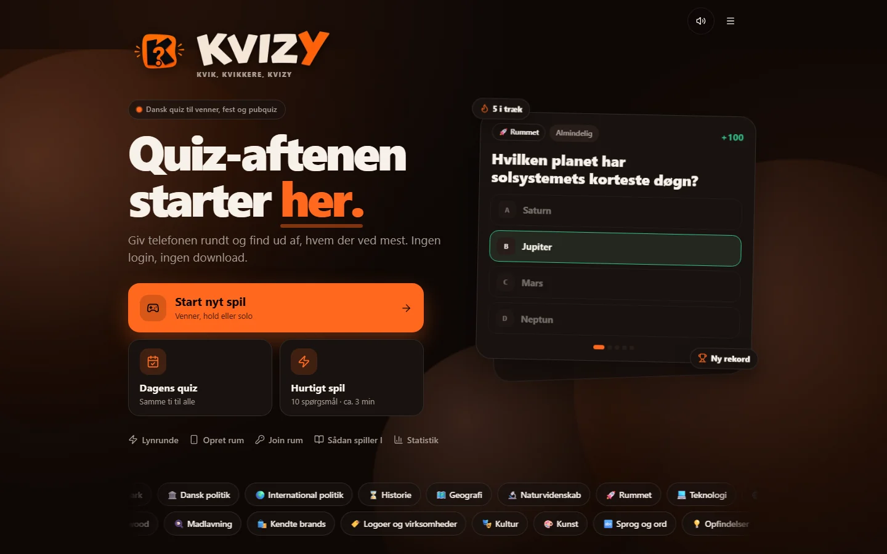
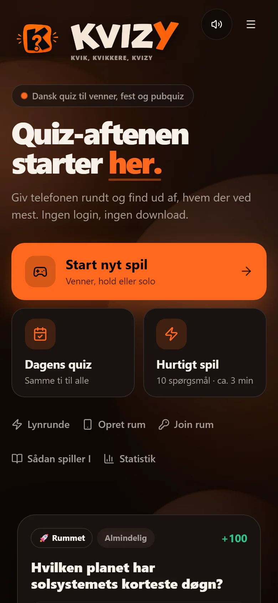

<p align="center"></p>
<p align="center"><b>KVIK, KVIKKERE, KVIZY.</b> A Danish quiz game for one shared screen, made for real game nights.</p>

<p align="center">
  <a href="https://kvizy-two.vercel.app"><b>Play it now</b></a> &nbsp;|&nbsp; <a href="#dokumentation-dansk">Dansk dokumentation</a>
</p>

<p align="center">
  
  
  
  
</p>



KVIZY is a mobile-first quiz in Danish for friends, families, parties, classrooms and pub quizzes. Hand the phone around, or open a room on a laptop or TV and let everyone join with a four-letter code or QR code and answer on their own phone. There is no login, no download and no AI key needed, and the core game keeps working without a connection.

<p align="center"><br><sub>The same game on a phone, which is how it is meant to be played.</sub></p>

## What it does

- **Six ways to play:** everyone against everyone, team battle, solo, quick quiz, risk and mystery mix, for 1 to 12 players or 2 to 6 teams.
- **Rooms without a server.** The room runs directly between devices over WebRTC (via the free PeerJS meeting server): no account, and the host just keeps the page open.
- **Daily quiz and lightning round.** The same ten questions for everyone each day with a shareable emoji result, and a 60-second sprint.
- **2,316 reviewed questions in 65 categories,** in 12 question types such as ordering, nearest-wins, statements and category crosses, with plausible answer options of the right type.
- **Fair by construction.** An anti-repeat selector combines similarity hashing, play history and difficulty so a question or a near-duplicate never appears twice in a game.
- **Installable and private.** PWA with offline play; usage statistics are daily counters only, with no tracking cookie or device profile.

## How it is built

Next.js 16 App Router, React 19 and strict TypeScript. Tailwind CSS 4, shadcn/ui and Motion for the interface. Drizzle with optional Neon PostgreSQL for the admin side, a Vercel AI SDK generator with Zod-validated output, and Vitest plus Playwright (mobile and desktop) for tests.

---

## Dokumentation (dansk)

**KVIK, KVIKKERE, KVIZY.** KVIZY er et komplet dansk, mobil-first quizspil til venner, familier, fester, undervisning og pubquiz. Første version er lokal multiplayer på én enhed og virker uden login, database eller AI-nøgle.

## Produktflow

0. **Rum:** Opret et rum på en laptop eller et tv, og lad alle joine med en firebogstavskode eller QR-kode og svare på deres egen telefon. Rummet kører direkte mellem enhederne (WebRTC via den gratis PeerJS-mødeserver), så det kræver ingen konto eller server. Værten skal holde siden åben. Der er også Lynrunde (60 sek.) og Dagens quiz.
0. Tryk på Dagens quiz for ti ens spørgsmål til alle spillere hver dag, med stime-tæller og delbart emoji-resultat.
1. Vælg Alle mod alle, Holdkamp, Solo, Hurtig quiz, Risiko eller Mystery Mix.
2. Tilføj 1–12 spillere eller 2–6 hold, og vælg mellem 65 søgbare kategorier.
3. Indstil et retfærdigt antal spørgsmål op til 90, niveau 1–5, fast/blandet/stigende sværhedsgrad samt timer-, tidsbonus-, minuspoint- og finaleindstillinger.
4. Giv enheden videre. Svar låses, forklaring og point vises, og spillet gemmes løbende. Et allerede set spørgsmål kan diskret byttes uden at koste turen.
5. Se vinder, scoreboard, svarprocent, streaks, gennemgang, historik og revanche.

## Stack og arkitektur

- Next.js 16 App Router, React 19.2 og strict TypeScript
- Tailwind CSS 4, shadcn/ui, Motion og AI Elements
- 2.316 redaktionelt gennemgåede spørgsmål med plausible, type-matchende svarmuligheder; offline kernespil og PWA-service worker
- 12 spørgsmålstyper, blandt andet rækkefølge, nærmest vinder, udsagn, beskrivelser og kategorikryds
- localStorage til aktivt spil, historik, indstillinger, set-historik og offline spillerrapporter
- Drizzle ORM + valgfri Neon PostgreSQL med lazy klientinitialisering
- Vercel AI SDK 6 `generateText` + `Output.object()` + Zod til validerede AI-batches
- Vitest og Playwright i Chromium på mobil- og desktop-viewports

## Lokal installation

Krav: Node.js 20.9+ og npm.

```bash
npm install
cp .env.example .env.local
npm run dev
```

Appen virker uden værdier i `.env.local`. Åbn `http://localhost:3000`.

## Miljøvariabler

| Variabel             |             Påkrævet | Formål                                               |
| -------------------- | -------------------: | ---------------------------------------------------- |
| `DATABASE_URL`       |                  Nej | Neon/PostgreSQL til central spørgsmålsadministration |
| `ADMIN_SECRET`       |         Ja for admin | Lang tilfældig hemmelighed; kontrolleres server-side |
| `VERCEL_OIDC_TOKEN`  | Automatisk på Vercel | AI Gateway-godkendelse                               |
| `AI_GATEWAY_API_KEY` |           Alternativ | Lokal AI Gateway-adgang                              |
| `AI_MODEL`           |                  Nej | Standard: `openai/gpt-5.4-mini`                      |

## Database

```bash
npm run db:generate
npm run db:migrate
npm run db:seed
```

Drizzle-skemaet modellerer kategorier, spørgsmål, spil, runder, spillere, hold, svar, plays, rapporter, generationsbatches og indstillinger. Klienten oprettes først ved faktisk brug, så build og kernespil aldrig afhænger af `DATABASE_URL`.

## Spørgsmålsbank og import/eksport

Seedbanken kombinerer håndskrevne spørgsmål med lokale snapshots fra Wikidata CC0. Distraktorer vælges inden for samme faktatype: eksempelvis hovedstæder mod hovedstæder, skuespillere mod skuespillere og sportsgrene mod sportsgrene. Alle 65 kategorier har mindst 30 semantisk relevante spørgsmål, og udvælgeren kan også bruge relevante sekundære kategorier. Nye kategorier tilføjes i `src/lib/categories.ts`.

Wikidata-importerne er langsomme, genoptagelige og gemmer efter hver relation. `--missing` springer allerede hentede relationer over:

```bash
npm run questions:update-wikidata
npm run questions:update-culture
npm run questions:update-thin -- --missing
```

```bash
npm run questions:export -- eksport.json
npm run questions:import -- eksport.json
```

Importkommandoen Zod-validerer hele filen og afviser dublerede fingerprints. Den ikke-linkede adminside på `/admin` kan søge, filtrere, redigere, aktivere/deaktivere, eksportere, previewe AI-batches, se kvalitetsadvarsler, privat aggregeret statistik og centralt synkroniserede spillerrapporter. Spørgsmålsbanken hentes serverfiltreret efter de valgte kategorier og gemmes som offline-fallback på enheden. AI vises som utilgængelig, hvis credentials mangler.

Efter hvert svar kan spilleren rapportere forkert svar, uklar formulering, forkert niveau, dårlige svarmuligheder eller forældet information. Rapporten gemmes først lokalt og synkroniseres derefter via `POST /api/reports`, når en database er tilgængelig. Ved tre rapporter sættes spørgsmålet automatisk i karantæne, indtil det gennemgås i admin. Generiske faktafelter skjules automatisk i spillet.

Den redaktionelle kvalitetspakke kontrollerer hvert aktivt spørgsmål for kunstigt maskinsprog, gentagelser, svarlæk, forkerte svartypekombinationer, dubletter og længdebias. Ens skabeloner og identiske svarpuljer begrænses i selve udvælgelsen og huskes på tværs af spil. Importerede Wikidata-spørgsmål kræver en eksplicit redaktionel godkendelse, før de kommer med i den aktive bank.

I Indstillinger kan spilleren oprette en etårig backupkode til set-historik og seneste opsætning. Koden gør det muligt at bevare anti-repeat efter geninstallation. Brugsstatistik gemmes kun som samlede dagstællere for startede/gennemførte spil, rapporter og valgte kategorier; der bruges ingen tracking-cookie eller enhedsprofil.

## AI-generator

`POST /api/admin/generate` er beskyttet af HttpOnly-admincookie og en enkel IP-rate-limit. Generatoren modtager kategori, sekundær kategori, niveau, antal og type. Output skal bestå schema-, sprog-, options-, banned phrase-, kilde- og nær-dubletkontrol. Godkendte spørgsmål lander som `draft`; de aktiveres ikke automatisk.

## Anti-repeat

Udvælgeren kombinerer stabil normalisering/hash, tokenbaseret Jaccard-similaritet, core-fact fingerprint, spillerens set-historik, seneste dato, antal visninger, sværhedsafstand, kategorifavoritter og type-/kategorisekvenser. Et spørgsmål eller en nær-dublet kan aldrig vælges to gange i samme spil.

## Test og kvalitet

```bash
npm run typecheck
npm run lint
npm test
npm run test:e2e
npm run build
npm run check
```

E2E-flowet dækker nyt spil, spillernavn, kategorier, niveau/længde, svar, spillerskift, refresh/fortsæt, afslutning, resultat, revanche, tomt udvalg, adminbeskyttelse samt mobil og desktop.

## Deployment på Vercel

```bash
vercel link
vercel env add ADMIN_SECRET production
vercel env add DATABASE_URL production  # valgfri
vercel --prod
```

Kør migration og seed mod produktions-`DATABASE_URL` før adminaktivering. Uden en produktionsdatabase bliver rapporter på spillerens enhed og forsøges synkroniseret igen senere. AI Gateway kan bruge Vercel OIDC; uden AI-adgang fungerer alle 2.316 seedspørgsmål stadig.

## Installation som mobilapp

Manifest, service worker, safe areas og standalone/fullscreen-visning er inkluderet. På understøttede Android-browsere vises en native “Installér KVIZY”-knap nederst i “Sådan spiller I”. På iPhone vises Safari-trinene “Del → Føj til hjemmeskærm”. Installationssektionen vises kun på mobil og skjules, når appen allerede kører installeret.

## Projektstruktur

- `src/components/game-shell.tsx` – samlet gæstespil og lokale flows
- `src/lib/engine.ts` – point, sværhedsgrad, shuffle, fingerprints og udvalg
- `src/data/` – kategoridrevet seedbank
- `src/lib/ai/` – struktureret generation og kvalitetskontrol
- `src/lib/db/` + `drizzle/` – typesikkert skema og migration
- `src/app/admin` + `src/app/api/admin` – beskyttet admin og generator
- `e2e/` og `src/lib/*.test.ts` – browser- og enhedstests

## Senere realtime-multiplayer

Den lokale `Game`-model og deterministiske `PlayerAnswer`-events kan flyttes til server-authoritative rooms. Tilføj rumkode, WebSocket/Realtime-transport og optimistic event reconciliation, mens den nuværende lokale reducer bevares som offline fallback. Login og profiler kan lægges ovenpå uden at ændre spørgsmålsbanken.

## Rum og netværk

Rum bruger WebRTC via den gratis PeerJS-mødeserver (0.peerjs.com), Googles STUN-servere og en åben TURN-relæ som sidste udvej. Vil du være uafhængig af dem, kan du sætte egne servere med miljøvariablerne `NEXT_PUBLIC_PEER_HOST`, `NEXT_PUBLIC_PEER_PORT`, `NEXT_PUBLIC_PEER_PATH` (egen PeerJS-server) og `NEXT_PUBLIC_TURN_URL`, `NEXT_PUBLIC_TURN_USER`, `NEXT_PUBLIC_TURN_CREDENTIAL` (egen TURN-server; flere adresser adskilles med komma). Værten kan genindlæse siden og få samme rumkode igen.
